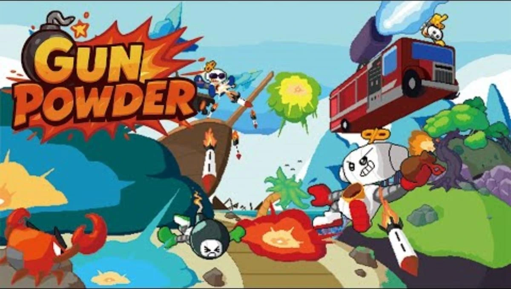
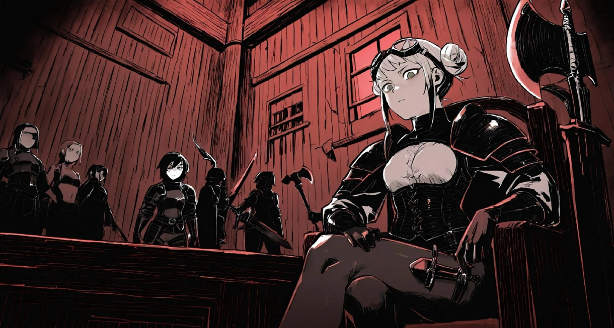
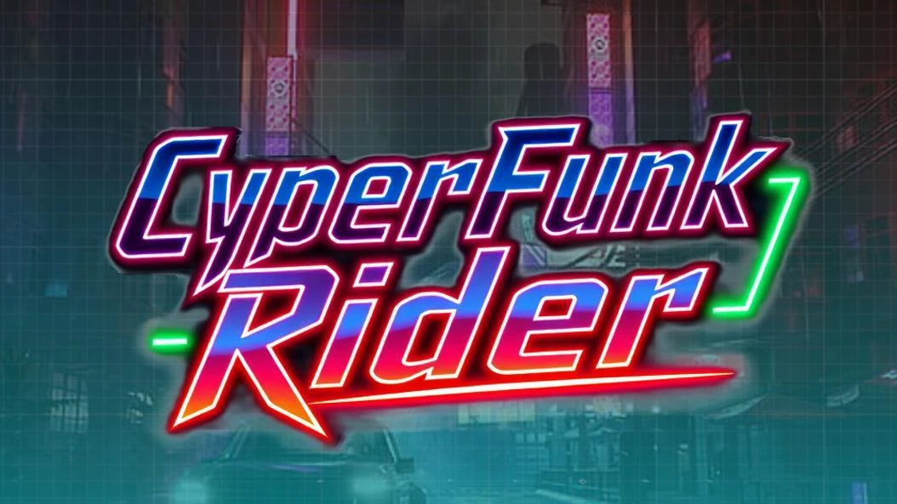
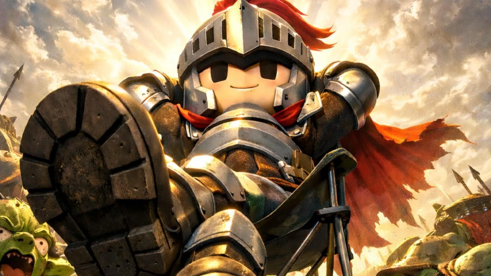

# 김경호 · 게임 클라이언트 개발자

라이크코퍼레이션에서 Unity 6로 VR 클라이언트를 개발하고 있습니다. 게임 프로젝트에서는 플레이어 전투, 파티 매치메이킹, 장비 시스템을 맡았습니다.

[게임 포트폴리오](https://guardkim.github.io/game-portfolio/)　·　[15인 매치 팀 배정 사례](https://guardkim.github.io/game-portfolio/#cravant-team)　·　[1인 개발 소스 코드](https://github.com/guardkim/SwordLordMaker)

  
  
  
  

## 경력

**라이크코퍼레이션 · Unity VR 클라이언트 개발**　2026.06 – 현재 
Meta XR SDK로 손 추적, 물체 잡기, 손가락으로 누르기 인터랙션을 구현했습니다. 전시·교육 현장에서 여러 HMD를 사용하는 환경을 고려해 콘텐츠를 개발합니다.

**라이크코퍼레이션 · 게임 개발 교육 과정 운영 지원**　2025.10 – 2026.04 
성균관대학교와 컴투스의 교육 과정에서 수업 보조자료를 구현하고 실습 가이드를 작성했습니다.

## 프로젝트

| 프로젝트 | 담당 구현 |
| --- | --- |
| [GunPowder](https://guardkim.github.io/game-portfolio/#gunpowder) · 팀 개발 | 기존 플레이어 코드의 피격 넉백과 투척 반동을 수정하고 카트리지 효과를 연결했습니다. **제2회 컴투스 글로벌 게임개발 공모전 컴:온 우수상**을 팀으로 수상했습니다. |
| [CRAVANT](https://guardkim.github.io/game-portfolio/#cravant-team) · 팀 개발 | 같은 파티가 서로 다른 팀에 배정되는 문제를 수정했습니다. 방장이 전원의 준비 상태를 확인한 뒤 15명을 5개 팀으로 나누도록 변경했습니다. |
| [Cyberfunk Rider](https://guardkim.github.io/game-portfolio/#cyberfunk) · 팀 개발 | 20칸 인벤토리와 장비 슬롯을 구현했습니다. 장비가 바뀌면 스탯과 UI가 이벤트를 받아 갱신됩니다. [팀 저장소](https://github.com/AByeong/CyberPunkRiderWaifu) |
| [검물주 키우기](https://guardkim.github.io/game-portfolio/#swordlord) · 1인 개발 | 18일간 만든 방치형 RPG 프로토타입입니다. 곡선별로 비행 검의 궤적을 분리하고 BigInteger 강화 수치를 저장했습니다. [개인 저장소](https://github.com/guardkim/SwordLordMaker) |

**개발 환경**　Unity 6, C#, Photon PUN2, Firebase, Meta XR SDK 
**그래픽스 작업**　[DirectX 11 / C++ 저장소](https://github.com/guardkim/2021_DX_Direct3D)
